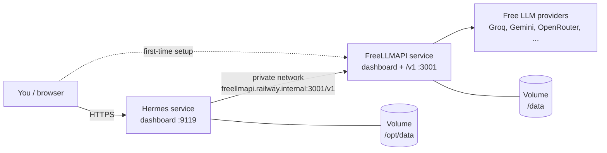

# Hermes Agent + FreeLLMAPI on Railway

One-click Railway deployment of [Hermes Agent](https://hermes-agent.nousresearch.com) powered by [FreeLLMAPI](https://github.com/tashfeenahmed/freellmapi), with persistent Railway volumes for both.

[](https://railway.com/deploy/YOUR_TEMPLATE_CODE)

> The button works once the Railway template is created (see "1. Create the Railway template" below). Replace `YOUR_TEMPLATE_CODE` with your template's code.

## What gets deployed



| Service | Folder | Volume | Public port | What it does |
|---|---|---|---|---|
| `FreeLLMAPI` | `freellmapi/` | `/data` | 3001 | Routes requests across your free provider keys behind one OpenAI-compatible `/v1` endpoint |
| `Hermes` | `hermes/` | `/opt/data` | 9119 | Hermes Agent gateway + dashboard; memories, sessions, skills and `config.yaml` live on the volume |

Hermes talks to FreeLLMAPI over Railway's private network, so model traffic never leaves your project.

## 1. Create the Railway template (once)

Railway can't create volumes or generate secrets from files in a repo, so this part is done once in the Railway dashboard. After that, the button above deploys everything in one click.

1. Open **Railway > your workspace > Templates > New template** (or go to https://railway.com/compose).
2. **Add the FreeLLMAPI service**
   - Add service > GitHub repo > `PROFFARO/railway-hermes-freellmapi`
   - Rename the service to exactly **`FreeLLMAPI`** (the Hermes variables reference this name)
   - Settings > Root directory: `/freellmapi`
   - Right-click the service > Attach volume > mount path **`/data`**
   - Settings > Networking > Public networking: enable HTTP, port **3001**
   - Variables:

     | Variable | Value |
     |---|---|
     | `PORT` | `3001` |
     | `HOST` | `::` |
     | `ENCRYPTION_KEY` | `${{secret(64, "abcdef0123456789")}}` |

3. **Add the Hermes service**
   - Add service > GitHub repo > `PROFFARO/railway-hermes-freellmapi`
   - Rename the service to **`Hermes`**
   - Settings > Root directory: `/hermes`
   - Right-click the service > Attach volume > mount path **`/opt/data`**
   - Settings > Networking > Public networking: enable HTTP, port **9119**
   - Variables:

     | Variable | Value |
     |---|---|
     | `PORT` | `9119` |
     | `FREELLMAPI_BASE_URL` | `http://${{FreeLLMAPI.RAILWAY_PRIVATE_DOMAIN}}:${{FreeLLMAPI.PORT}}/v1` |
     | `FREELLMAPI_KEY` | leave empty, filled in after first-time setup |
     | `API_SERVER_KEY` | `${{secret(48)}}` |
     | `HERMES_DASHBOARD_BASIC_AUTH_USERNAME` | `admin` |
     | `HERMES_DASHBOARD_BASIC_AUTH_PASSWORD` | `${{secret(24)}}` |

4. Click **Create template**, copy its link (`https://railway.com/deploy/...`) and replace `YOUR_TEMPLATE_CODE` in the button above.

The `secret(...)` values are generated fresh for every deployment, so no secret is ever stored in this repo.

## 2. Deploy

Click **Deploy on Railway**. Railway builds both services, creates both volumes, generates the secrets and wires Hermes to FreeLLMAPI automatically.

## 3. First-time setup (about 5 minutes)

FreeLLMAPI needs your own free provider keys before Hermes can answer. This is the only manual step.

1. Open the **FreeLLMAPI** service's public URL.
2. Add the free API keys you want to use (Groq, Google Gemini, OpenRouter, Cerebras, Mistral, ...).
3. Copy the **unified API key** FreeLLMAPI shows you.
4. In Railway, open the **Hermes** service > Variables > set `FREELLMAPI_KEY` to that key > Deploy.
5. Open the **Hermes** public URL and sign in with `admin` and the password from `HERMES_DASHBOARD_BASIC_AUTH_PASSWORD` (Hermes > Variables).
6. **Recommended:** remove FreeLLMAPI's public domain (FreeLLMAPI > Settings > Networking). Hermes keeps working over the private network, and your provider keys are no longer reachable from the internet. Add the domain back whenever you need the dashboard again.

## Variables reference

### Hermes

| Variable | Default | Purpose |
|---|---|---|
| `FREELLMAPI_BASE_URL` | `http://freellmapi.railway.internal:3001/v1` | FreeLLMAPI endpoint Hermes uses |
| `FREELLMAPI_KEY` | none | Unified key from the FreeLLMAPI dashboard |
| `HERMES_MODEL` | `auto` | Model name sent to FreeLLMAPI (`auto` lets it route) |
| `HERMES_RESET_CONFIG` | `false` | Set to `true` for one deploy to rewrite the model settings in `config.yaml` (the old file is backed up) |
| `API_SERVER_KEY` | none | Key for Hermes' OpenAI-compatible API on port 8642 (required while `API_SERVER_ENABLED=true`) |
| `HERMES_DASHBOARD_BASIC_AUTH_USERNAME` / `_PASSWORD` | none | Dashboard sign-in (required while the dashboard is on) |
| `HERMES_DASHBOARD_OAUTH_CLIENT_ID` | none | Optional: sign in with Nous Portal instead of a password |
| `HERMES_DASHBOARD` | `1` | Set to `0` to turn the dashboard off |
| `HERMES_VERSION` | `latest` | Build argument: pin a tested `nousresearch/hermes-agent` tag |

### FreeLLMAPI

| Variable | Default | Purpose |
|---|---|---|
| `ENCRYPTION_KEY` | none | 64-character hex key that encrypts stored provider keys. Never change it after setup, or stored keys become unreadable |
| `PORT` | `3001` | Listening port |
| `HOST` | `::` | Listening address (`::` covers IPv4 and IPv6 for Railway's private network) |
| `FREELLMAPI_DATA_DIR` | `/data` | Where data is stored (the volume) |
| `FREELLMAPI_VERSION` | `latest` | Build argument: pin a FreeLLMAPI npm version |

## Updating

Redeploy a service in Railway to pull the latest Hermes image or FreeLLMAPI release. Data on the volumes is kept. To control upgrades, pin `HERMES_VERSION` / `FREELLMAPI_VERSION`.

## Troubleshooting

- **Hermes replies with connection errors:** check `FREELLMAPI_KEY` is set and the FreeLLMAPI service is running. The Hermes deploy log prints the model endpoint it uses.
- **FreeLLMAPI doesn't start or isn't reachable privately:** set `HOST` to `0.0.0.0` on the FreeLLMAPI service and redeploy.
- **Hermes exits right away:** the deploy log names the missing variable (dashboard sign-in or `API_SERVER_KEY`).
- **"no Railway volume is mounted" warning:** attach a volume at `/opt/data` (Hermes) or `/data` (FreeLLMAPI).
- **Changed `FREELLMAPI_BASE_URL` but Hermes still uses the old one:** set `HERMES_RESET_CONFIG=true`, deploy once, then remove it.

## Repository layout

```
freellmapi/
  Dockerfile    # Node 22 + freellmapi from npm
  start.sh      # stores data on the /data volume, listens on Railway's network
hermes/
  Dockerfile    # official nousresearch/hermes-agent image + wrapper
  entrypoint.sh # checks secrets, writes model settings, starts Hermes via the image's dispatcher
```
